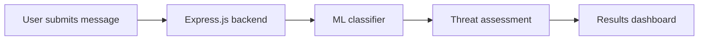

<div align="center">

# 🛡️ ScamShield AI

### Detect scams. Understand threats. Stay protected.

An AI-powered platform that helps users identify fraudulent messages, understand suspicious patterns, and defend against phishing and social engineering attacks.


[Demo](#-demo) • [Features](#-features) • [How It Works](#-how-it-works) • [Getting Started](#-getting-started) • [Team](#-team)

</div>

---

## 📖 Table of Contents

- [Overview](#-overview)
- [Demo](#-demo)
- [Features](#-features)
- [Tech Stack](#-tech-stack)
- [How It Works](#-how-it-works)
- [Project Goals](#-project-goals)
- [Getting Started](#-getting-started)
- [Team](#-team)
- [Acknowledgments](#-acknowledgments)

---

## 💡 Overview

ScamShield AI analyzes suspicious messages using a machine learning classifier to flag potential scams and help users understand the risks behind them.

Most scam detection tools only label a message as "safe" or "dangerous." **ScamShield AI goes a step further**: it explains the suspicious language, identifies manipulation tactics, and gives actionable safety recommendations so users learn to spot scams on their own.

---

## 🎥 Demo

<!-- Replace these with your own assets -->
<!--  -->
<!-- 📺 [Watch the demo video](YOUR_VIDEO_LINK) -->
<!-- 🌐 [Live demo](YOUR_DEPLOYED_LINK) -->

*Screenshots and demo link coming soon.*

---

## ✨ Features

| Feature | Description |
|---|---|
| 🤖 **AI-Powered Scam Detection** | Analyzes suspicious messages to identify potential scams. |
| 🧠 **Scam Conversation Breakdown** | Explains why a message may be dangerous and highlights common psychological manipulation tactics. |
| 📊 **Risk Assessment** | Communicates threat level through an easy-to-understand risk score. |
| 🚩 **Suspicious Phrase Detection** | Flags red flags such as urgency, impersonation, suspicious links, and requests for sensitive information. |
| ✅ **Safety Recommendations** | Provides clear, actionable guidance to avoid fraudulent interactions. |

---

## 🛠️ Tech Stack

| Category | Technologies |
|---|---|
| **Frontend** | React, TypeScript, Tailwind CSS |
| **Backend** | Node.js, Express.js |
| **AI / ML** | Provided machine learning classifier |
| **Version Control** | Git, GitHub |

---

## ⚙️ How It Works



1. **Message Submission:** The user submits a suspicious message for analysis.
2. **Backend Processing:** The Express.js backend receives the request.
3. **AI Analysis:** The message is processed by the machine learning classifier.
4. **Threat Assessment:** The system evaluates the message and identifies potential scam indicators.
5. **Results:** The frontend displays the analysis, risk score, highlighted suspicious phrases, and safety recommendations.

---

## 🎯 Project Goals

- Make scam detection more accessible and understandable.
- Help users recognize phishing and social engineering techniques.
- Raise awareness about common scam tactics.
- Encourage safer digital communication and online behavior.

---

## 🚀 Getting Started

### Prerequisites

- [Node.js](https://nodejs.org/) (v18 or higher recommended)
- npm
- Git

### Installation

**1. Clone the repository**

```bash
git clone https://github.com/YOUR-USERNAME/ScamShield-AI.git
cd ScamShield-AI
```

**2. Install dependencies**

```bash
npm install
```

**3. Configure environment variables**

Create a `.env` file in the project root (or in your backend folder):

```env
PORT=5000
# Add any API keys or classifier configuration here
```

**4. Start the development server**

```bash
npm run dev
```

> **Note:** Update these steps to match your actual frontend/backend folder structure (e.g., run `npm install` and `npm run dev` separately in `/client` and `/server`).

---

## 👥 Team

Built with ❤️ at **HackUTD 2026**.

| Name | Role | GitHub |
|---|---|---|
| Your Name | Frontend / Backend / ML | [@username](https://github.com/username) |
| Teammate | Role | [@username](https://github.com/username) |

---

## 📌 Acknowledgments

Developed as part of HackUTD, with a focus on improving digital safety and helping people recognize and understand fraudulent communications.

---

<div align="center">

**ScamShield AI** — *More than scam detection. A smarter way to stay protected.*

</div>
